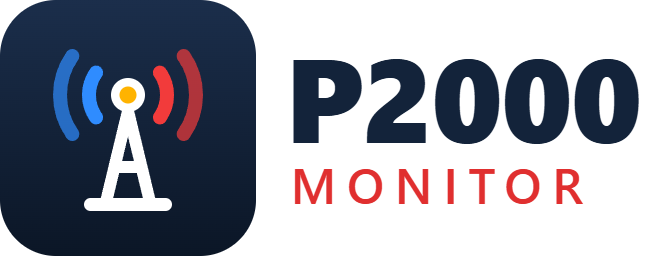

<p align="center"></p>

# P2000 Monitor for Home Assistant

Live Dutch P2000 emergency alerts in Home Assistant, from the structured **AlarmeringDroid API**. Like [P2Kflex](https://live.p2kflex.nl/), you decide what you follow — entirely from the UI: your own sensors per region or service, alarms for your own capcodes or vehicles, and a live dashboard card.

[](https://my.home-assistant.io/redirect/hacs_repository/?owner=Anonymouse0104&repository=ha-p2000-monitor&category=integration) [](https://ko-fi.com/anonymouse0501)

## Features

- **Your own sensors** — add the integration once, then use **Add sensor** for every view you want: all of the Netherlands, your safety region, the fire brigade within 20 km of home, or one station by capcode.
- **Follow capcodes or vehicles** — **Follow capcode or vehicle** creates an *Alarm* event and an *Active* sensor for automations, no YAML needed. A blueprint sends a push notification.
- **Live card** — a P2Kflex-style list (`custom:p2000-live-card`) with service colours, priority, GRIP, vehicles and capcodes, switchable between alert text and pager text. Loaded automatically.
- **Map** — alerts with a location from the last hour appear on the standard map card.
- **Vehicles named** — call signs in fire brigade pager texts (24-0733) are shown with type and post from [Brandbase](https://brandbase.hetbrandweerforum.nl/) (can be switched off).
- **Pager text or alert text** — choose per sensor: `P 1 BR woning Rijksweg Echt` or `Brandweer met spoed naar Rijksweg, Echt`.
- **One poll for everything** — the national feed is fetched once every 30 seconds (adjustable from 30 to 300 under **P2000 Monitor → Configure**), however many sensors you have. A longer interval misses nothing: the feed holds the latest ~30 national alerts and every alert is deduplicated.
- **No missed or duplicate alerts** — every alert is deduplicated on its AlarmeringDroid id and fires exactly one event; each sensor keeps its last 100 alerts across restarts.

## Installation

1. In **HACS**, open the menu (⋮) → **Custom repositories**, add `https://github.com/Anonymouse0104/ha-p2000-monitor` as type **Integration**.
2. Install **P2000 Monitor** and restart Home Assistant.
3. Go to **Settings → Devices & services → Add integration → P2000 Monitor** and set up your first sensor.

Requires Home Assistant 2025.6 or newer.

## Adding sensors

Open **Settings → Devices & services → P2000 Monitor** and click **Add sensor**. Every sensor becomes its own entity (`sensor.<name>`). Use the ⋮ menu next to a sensor to change or delete it.

| Filter | Meaning |
|---|---|
| **Show all alerts** | All of the Netherlands; ignores region, service, priority, capcode and vehicle filters (text and radius filters still apply). |
| **Safety regions** | One or more of the 25 Veiligheidsregio's. |
| **Services** | Politie, Brandweer, Ambulance, KNRM, Lifeliner, DARES. |
| **Priorities** | P1 to P5. Ambulance A1 counts as P1, A2 as P2 and B as P3. |
| **Capcodes** | Comma separated; an alert matches if any of its capcodes matches. |
| **Vehicles** | Comma separated call signs from the pager text, e.g. `24-0733`. |
| **Text must contain / must not contain** | Comma separated terms, matched in alert text and pager text. |
| **Radius around home** | Only alerts within this many km of your Home Assistant home location. |
| **Display** | Sensor state shows the alert text or the pager text. |
| **Incident grouping window** | How long follow-up alerts join the same incident. |

Values **within** one filter are **OR**, different filters are **AND**. Empty filters are ignored.

### Examples

| Sensor | Settings |
|---|---|
| **P2000 Nederland** | Show all alerts |
| **Brandweer Limburg** | Regions *Limburg-Noord* + *Zuid-Limburg*, service *Brandweer* |
| **Dichtbij** | Radius *15 km* |
| **Ambulance Utrecht** | Region *Utrecht*, service *Ambulance*, priority *P1* |
| **Zeer urgent** | Priority *P1*, display *pager text* |

## Following capcodes or vehicles

Click **Follow capcode or vehicle**, give it a name and enter capcodes and/or call signs (either one is enough). You get a device with:

- **Alarm** (`event.<name>_alarm`) — fires once per alert. In the automation editor pick *Entity → State* on it; the event data contains `message`, `pager_text`, `priority`, `vehicles`, `vehicle_types`, `city`, `latitude`/`longitude` and more.
- **Active** (`binary_sensor.<name>_active`) — on for a set number of minutes after the last alarm; handy for a dashboard or a light.

[](https://my.home-assistant.io/redirect/blueprint_import/?blueprint_url=https%3A%2F%2Fgithub.com%2FAnonymouse0104%2Fha-p2000-monitor%2Fblob%2Fmain%2Fblueprints%2Fautomation%2Fp2000_monitor%2Fp2000_alarm_notify.yaml)
The **P2000 alarm melden** blueprint sends a push notification to your phone for a followed unit.

## Live dashboard

The live card is loaded automatically. Add it via **Edit dashboard → Add card → P2000 live** and pick one or more P2000 sensors, or in YAML:

```yaml
type: custom:p2000-live-card
entities:
  - sensor.p2000_monitor
display: both   # text, pager or both
max_items: 40
```

Click an alert to see the pager text, the alerted vehicles (with Brandbase names) and the capcodes. The service chips show today's count and hide or show that service. For the map, add a **Map** card with `geo_location_sources: [p2000_monitor]`. A complete example dashboard is in [`dashboards/p2000_live.yaml`](dashboards/p2000_live.yaml).

## Vehicle names (Brandbase)

Fire brigade pager texts end with the call signs of the alerted units (`243231` → `24-3231`). P2000 Monitor looks these up on [Brandbase](https://brandbase.hetbrandweerforum.nl/) to show the vehicle type and post. To keep the load on this volunteer-run site minimal it only fetches regions that appear in alerts your sensors accept, each at most once a week, one page at a time with 15 seconds in between, and caches the result. Switch it off under **P2000 Monitor → Configure**. Corrections to vehicle data go to the Brandbase editors.

## Integration options

Under **Settings → Devices & services → P2000 Monitor → Configure**:

| Option | Default | Meaning |
|---|---|---|
| **Poll interval** | 30 s | How often the national feed is fetched, for all sensors together (30–300 s). The AlarmeringDroid API is a free third-party service; please keep this modest. |
| **Look up vehicle names on Brandbase** | on | See [Vehicle names](#vehicle-names-brandbase) above. |

## Upgrading from 0.7 or older

Before 0.8, every sensor was a separate integration entry. On the first start of 0.8 these are merged automatically into one **P2000 Monitor** entry with one sensor per old entry. Entity IDs, history and stored alerts are kept, so dashboards and automations keep working.

## Services

| ID | Service |
|---:|---|
| 1 | Politie |
| 2 | Brandweer |
| 3 | Ambulance |
| 4 | KNRM |
| 5 | Lifeliner |
| 7 | DARES |

## Troubleshooting

A filtered sensor must never receive a message outside its configured region or service. For example, a message from Enschede (Twente, region 23) must not appear on **Brandweer Limburg-Noord** (region 15).

Useful debug messages are written under the `p2000_monitor` logger.

## Events

The feed is polled once for all sensors. Each message is deduplicated on its AlarmeringDroid id.

| Event | Fired | Data |
|---|---|---|
| `p2000_monitor_new_message` | once per new message, for the whole feed | `message` |
| `p2000_monitor_filter_match` | once per new message per sensor whose filters accept it | `message`, `filter`, `entry_id`, `subentry_id`, `sensor` |
| `p2000_monitor_new_incident` / `p2000_monitor_incident_update` | per sensor | `incident`, `message`, `entry_id`, `subentry_id`, `sensor` |

Use `p2000_monitor_filter_match` with a `sensor` condition (for example `sensor.brandweer_limburg`) for automations on one sensor. `p2000_monitor_new_message` has no `sensor` field.

The large attributes `meldingen`, `incidenten`, `incident_history`, `incident` and `capcodes` are available in the state machine but are not stored by the recorder.

## Legacy YAML

YAML configuration (`sensor: - platform: p2000_monitor`) is no longer supported. Remove it from `configuration.yaml`, then delete the orphaned `p2000_monitor_main` / `..._legacy_N` entities under **Settings → Entities**.

## Data source

Alerts come from the AlarmeringDroid API. Its feed only holds the latest ~30 national alerts, which is why every sensor keeps its own history.

## License

MIT.
